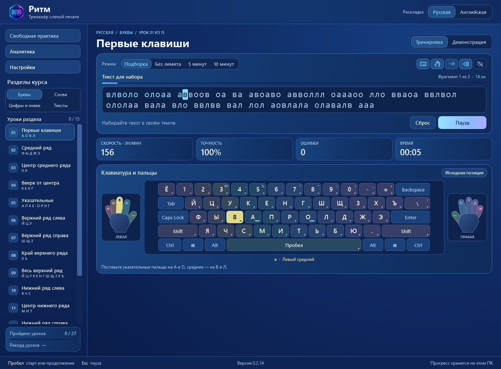
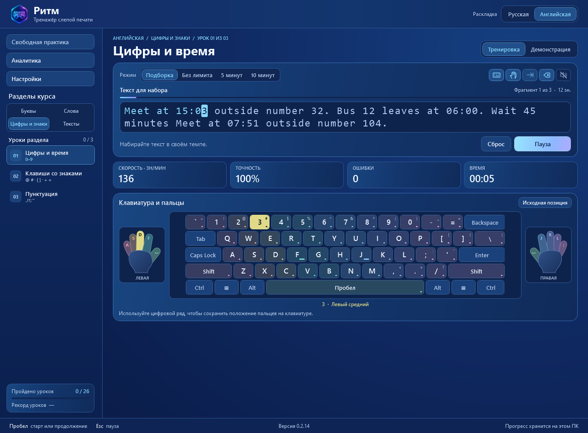
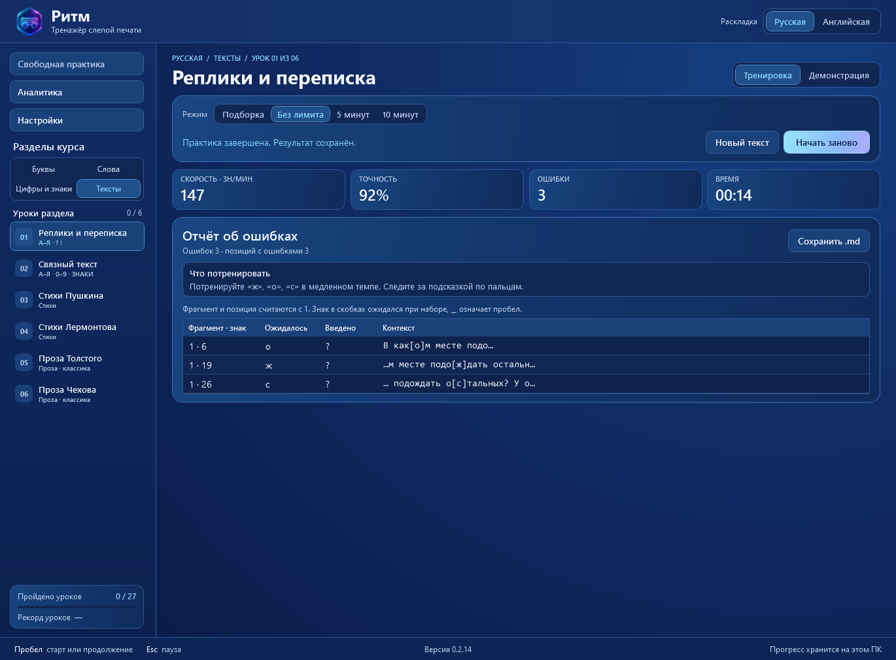
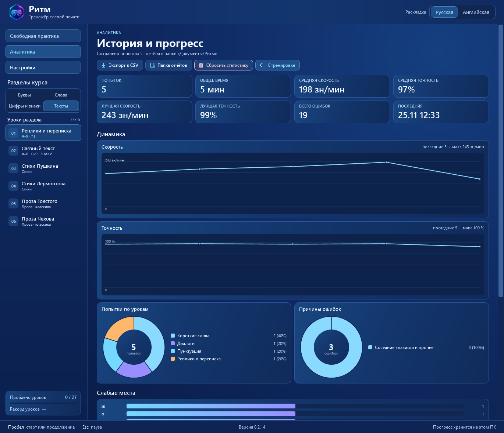
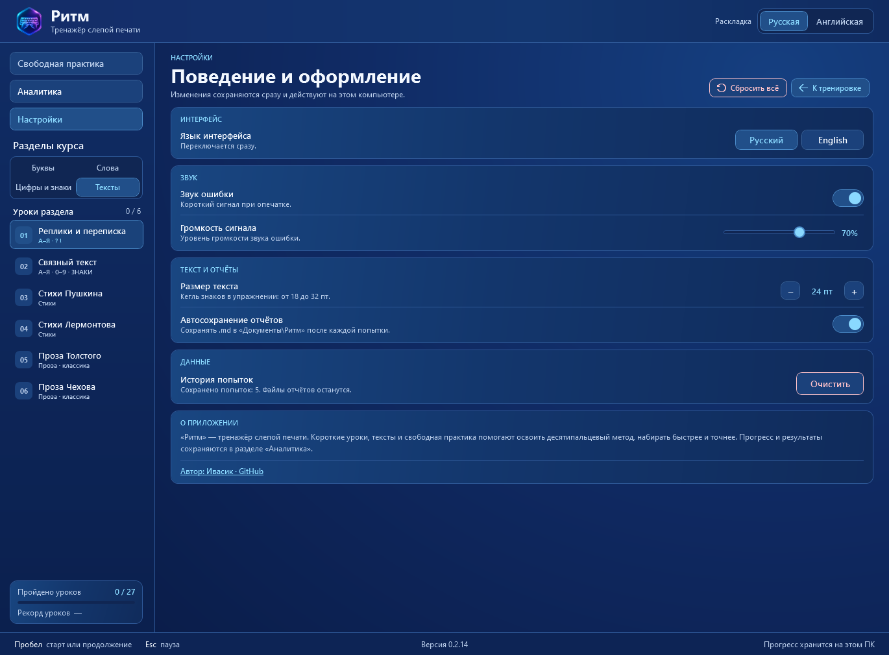

# РИТМ

«Ритм» — тренажёр десятипальцевого набора для Windows. В версии 0.2.14 есть отдельные курсы для русской ЙЦУКЕН и английской QWERTY, демонстрация движений пальцев, диктант и история попыток с разбором ошибок.

**[Скачать Ритм 0.2.14 для Windows](https://github.com/IvasikDev/RITM/releases/download/v0.2.14/Rhythm-0.2.14.exe)** · [Страница тестовой версии](https://github.com/IvasikDev/RITM/releases/tag/v0.2.14)

Приложение запускается из EXE без установки. Для диктанта используется установленный в Windows голос для выбранного языка. Раскладку курса можно выбирать независимо от языка интерфейса.



## Курсы и упражнения

В русском курсе 27 уроков, в английском — 26. В каждом курсе есть четыре раздела.

| Раздел | Что тренируется |
| --- | --- |
| Буквы | Исходный ряд, движения отдельными пальцами, верхний и нижний ряды, набор заглавных букв с Shift. |
| Слова | Короткие, частые и длинные слова. В английском курсе есть отдельный урок на буквосочетания. |
| Цифры и знаки | Цифровой ряд, время, символы и пунктуация. |
| Тексты | Переписка, связные отрывки и литература. В русском курсе есть стихи Пушкина и Лермонтова, проза Толстого и Чехова. В английском — сонеты Шекспира, другие стихи и проза. |

**Подборка** даёт конечное упражнение по теме урока. **Без лимита** продолжает выдавать материал до завершения пользователем. **5 минут** и **10 минут** задают длительность попытки. В **Свободной практике** можно начать с разнообразных текстов выбранного языка без выбора конкретного урока.

<details>
<summary>Английская раскладка и урок на цифры</summary>



</details>

## Подсказки, диктант и ошибки

- **Демонстрация** показывает клавишу и нужный палец, выделяя каждый знак на 0,85 секунды. Кнопка «Исходная позиция» показывает, куда поставить пальцы перед набором.
- **Клавиатура и руки** включаются независимо. Эти переключатели работают и в диктанте.
- **Диктант** скрывает ещё не набранный текст и озвучивает его предложениями. Следующий отрывок звучит после ввода текущего. Для материала без предложений, например списков слов, программа читает короткие группы. **F4** повторяет текущий отрывок с начала.
- **Опечатки** можно исправлять сразу или идти к следующему знаку. В режиме с исправлением курсор ждёт правильного символа. В режиме с пропуском ошибка записывается, а курсор двигается дальше. Отдельный переключатель разрешает **Backspace** для возврата к предыдущему знаку. Громкость звука ошибки регулируется отдельно.
- **Пробел** запускает или продолжает упражнение. **Esc** ставит его на паузу.

## Отчёты и аналитика

Во время попытки видны скорость в знаках в минуту, точность, число ошибок и время. Итоговый отчёт показывает позицию ошибки, ожидаемый и введённый символы, контекст и рекомендации по конкретным знакам. Отчёт можно сохранить в Markdown вручную или включить автосохранение в папку `Документы\Ритм`.



Аналитика хранит историю попыток, показывает средние и лучшие результаты, графики скорости и точности, распределение попыток по урокам, причины ошибок и символы, на которых чаще возникают опечатки. Кнопка **«Экспорт в CSV»** выгружает историю для работы в таблицах. Экспорт отчёта .md сохраняет детали отдельной попытки, а CSV удобен для сравнения серии тренировок.



## Настройки

Можно переключить язык интерфейса между русским и английским, изменить размер текста упражнения от 18 до 32 пт, выключить сигнал ошибки или отрегулировать его громкость. Здесь же включается автосохранение отчётов. Настройки применяются сразу и хранятся на этом компьютере. Историю попыток можно очистить отдельно от сохранённых файлов отчётов.

<details>
<summary>Экран настроек</summary>



</details>

## Исходный код и сборка

Папка [`src/`](src/) содержит исходники **0.2.13** на C# и WPF. Описание и скриншоты выше относятся к сборке **0.2.14**, доступной в GitHub Releases.

Чтобы собрать 0.2.13, запустите в PowerShell на Windows из корня репозитория:

```powershell
.\src\build.ps1 -Executable RhythmTyping.exe
```

Сценарий использует компилятор .NET Framework и библиотеки WPF. Собранный файл появится в `src/RhythmTyping.exe`.

Автор — Ивасик.
